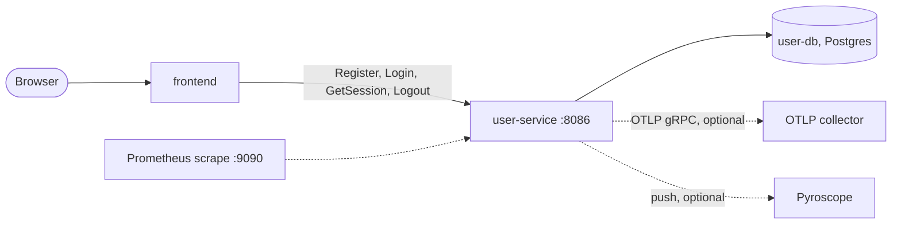

# Architecture

## Context



user-service calls no other service. The only caller is the frontend (`Register`, `Login`, `GetSession` and `Logout` in `cmd/server/accounts.go`; checked against the `origin/main` code of the callers on 2026-11-21). The frontend uses the resolved user for the header, the order history (`ClaimOrders` in order-service) and the cart identity.

## Main flow: register, resolve, log out

```mermaid
sequenceDiagram
    participant FE as frontend
    participant US as user-service
    participant DB as user-db
    FE->>US: Register(email, password, name)
    US->>US: validate, register rate limit, bcrypt hash
    US->>DB: BEGIN; INSERT user; INSERT session (SHA-256 of token); COMMIT
    US-->>FE: user, token, expires_at
    FE->>US: GetSession(token)
    US->>DB: SELECT ... WHERE token_hash = sha256(token) AND not expired AND not revoked
    US-->>FE: user
    FE->>US: Logout(token)
    US->>DB: UPDATE sessions SET revoked_at (only if not yet revoked)
    US-->>FE: OK
```

## Start-up and readiness

1. Configuration is read (bad `BCRYPT_COST`, `SESSION_TTL` or `*_RATE_*` values stop the process; telemetry and profiling are off unless their variables are set).
2. One random password is hashed (the dummy for unknown e-mails at login).
3. The gRPC server listens at once, health is `NOT_SERVING`.
4. A background loop runs the goose migrations (retry every 2 s), then pings the database every 5 s; health follows the ping.

## Login failure path

An unknown address, a wrong password, a malformed address and a password over 72 bytes take the same path and give the same code and message. For an unknown address the service compares against a dummy bcrypt hash made at the configured cost, so a failed login costs exactly one bcrypt comparison either way (a unit test counts the comparisons; response times were not measured). The attempt is counted by the rate limiter before the password is checked.

## Storage

See the Data section of the README in the repository root: tables `users` and `sessions`, one migration (`00001_create_users.sql`).
